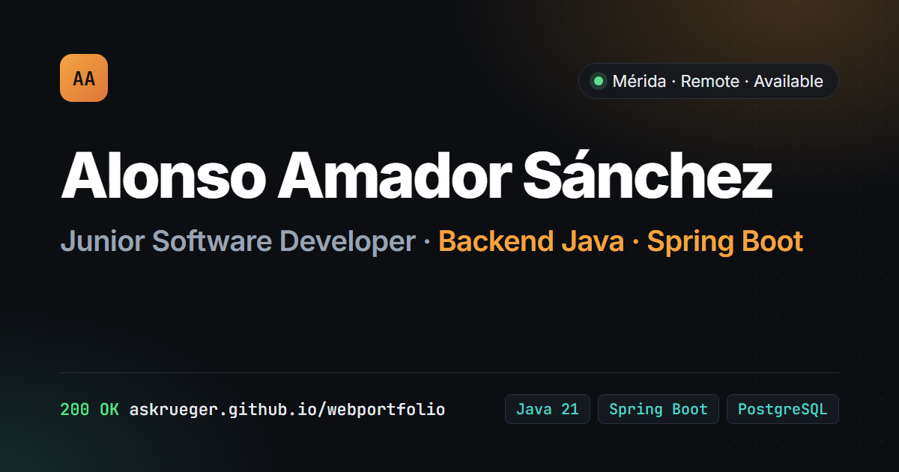

# Alonso Amador Sánchez · Portfolio

[](https://github.com/AsKrueger/webportfolio/actions/workflows/deploy.yml)

**Desarrollador de Software Junior · Backend con Java y Spring Boot** · Mérida, Extremadura · Disponibilidad inmediata

🌐 **[askrueger.github.io/webportfolio](https://askrueger.github.io/webportfolio/)** ([English](https://askrueger.github.io/webportfolio/en/)) · [CV en PDF](https://askrueger.github.io/webportfolio/cv/alonso-amador-sanchez-cv.pdf) · [LinkedIn](https://www.linkedin.com/in/alonso-amador) · [Email](mailto:alonsoamadorsanchez@gmail.com)

[](https://askrueger.github.io/webportfolio/)

---

## Proyectos destacados

| Proyecto | Qué es | Stack principal |
| --- | --- | --- |
| [**Cosplay Journal**](https://github.com/AsKrueger/Cosplay-Journal) | Backend hexagonal con eventos Kafka, JWT, scraper idempotente y Testcontainers | Java 21 · Spring Boot 3 · PostgreSQL · Kafka |
| [**3D Cost Manager**](https://github.com/AsKrueger/Calculadora3D) | Motor de costes de impresión 3D con DDD, cliente Android e infraestructura AWS como código | Java 21 · Spring Boot · Kotlin · AWS |
| [**ExplorerSaga Extremadura**](https://github.com/AsKrueger/ExplorerSaga-Extremadura) | TFG: guía turística de Mérida con mapa OSM y backend propio | Kotlin · Jetpack Compose · Spring Boot |
| [PantryMind](https://github.com/AsKrueger/PantryMind) · [Wayly](https://github.com/AsKrueger/Wayly) · [BingoGoals](https://github.com/AsKrueger/BingoGoals) | Proyectos web en TypeScript | NestJS · React · Angular |

Cada proyecto destacado tiene en la web su caso técnico: problema, **diagrama de arquitectura**, **un fragmento de código real** del repositorio y el estado real del proyecto.

---

## Sobre este repositorio

El sitio es estático y lo genera un script de Python pequeño. No usa framework de frontend ni llama a APIs durante el build: el contenido sale de [`data.json`](data.json) y los textos de la interfaz de [`ui.json`](ui.json), así que el resultado es siempre el mismo.

```
data.json + ui.json + snippets/ ──► build.py (Jinja2 + Pygments) ──► dist/ (es + en + PDF) ──► GitHub Actions ──► gh-pages
```

```
.
├── build.py                 # generador: valida, traduce, resalta código, sitemap, PDF
├── data.json                # contenido; cada texto traducible es {"es": …, "en": …}
├── ui.json                  # textos de la interfaz en los dos idiomas
├── snippets/                # fragmentos literales de los repos que se enseñan en la web
├── templates/
│   ├── base.html            # layout, SEO, Open Graph, hreflang, selector de idioma
│   ├── index.html           # portada de una sola página
│   ├── project.html         # caso técnico → /proyectos/<slug>/ y /en/projects/<slug>/
│   ├── cv.html              # CV de una página A4 (también se exporta a PDF)
│   ├── diagrams/*.svg       # diagramas de arquitectura, adaptados al tema claro/oscuro
│   ├── 404.html · redirect.html · _macros.html
├── static/                  # CSS, JS sin dependencias, fuentes (OFL) e imágenes
├── tools/                   # plantilla y script de la imagen para redes (og.png)
└── .github/workflows/deploy.yml
```

### Detalles

- **Bilingüe**: español en `/` e inglés en `/en/`, con `hreflang` y selector de idioma en cada página.
- **CV en PDF**: `build.py --pdf` imprime `/cv/` con Chrome headless; el workflow lo hace en cada despliegue.
- **Código real con resaltado**: Pygments en tiempo de build, sin JavaScript.
- **Diagramas SVG en línea** que cambian de color con el tema.
- **Tema claro/oscuro**: sigue al sistema y recuerda la elección.
- **Accesibilidad**: HTML semántico, enlace para saltar al contenido, foco visible, `prefers-reduced-motion`, diagramas con descripción.
- **SEO y redes**: canonical, Open Graph con imagen 1200×630, `sitemap.xml`, `robots.txt` y JSON-LD `Person`.
- **Rendimiento**: fuentes alojadas en el propio sitio, sin librerías de terceros.
- **Enlaces antiguos**: `/sobre-mi/`, `/curriculum.html`, etc. redirigen a la sección nueva.
- **Validación**: el build falla si falta un campo obligatorio, si hay slugs repetidos o si un fragmento no existe.

## Desarrollo local

```bash
pip install -r requirements.txt
python build.py --serve          # http://localhost:8000
python build.py --pdf --serve    # también genera los PDF (necesita Chrome)
python tools/make_og.py          # regenera static/img/og.png
```

Para añadir un proyecto, añade un objeto a `projects` en `data.json`. Con `"featured": true` aparece en grande en la portada. Para que tenga diagrama, crea `templates/diagrams/<slug>.svg`; para enseñar código, añade un fichero en `snippets/` y una clave `snippet`.

## Despliegue

Cada push a `main` ejecuta [`deploy.yml`](.github/workflows/deploy.yml), que genera el sitio y los PDF y publica `dist/` en la rama `gh-pages`. En los pull requests solo se comprueba que el build funciona.

## Licencia

Código bajo [MIT](LICENSE) © Alonso Amador Sánchez. Fuentes Inter y JetBrains Mono bajo SIL Open Font License.
